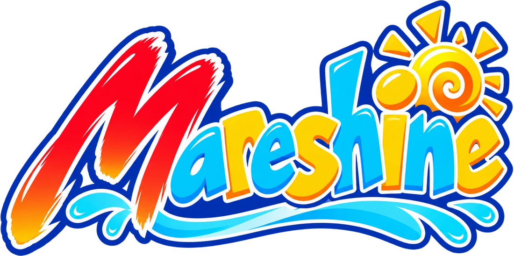
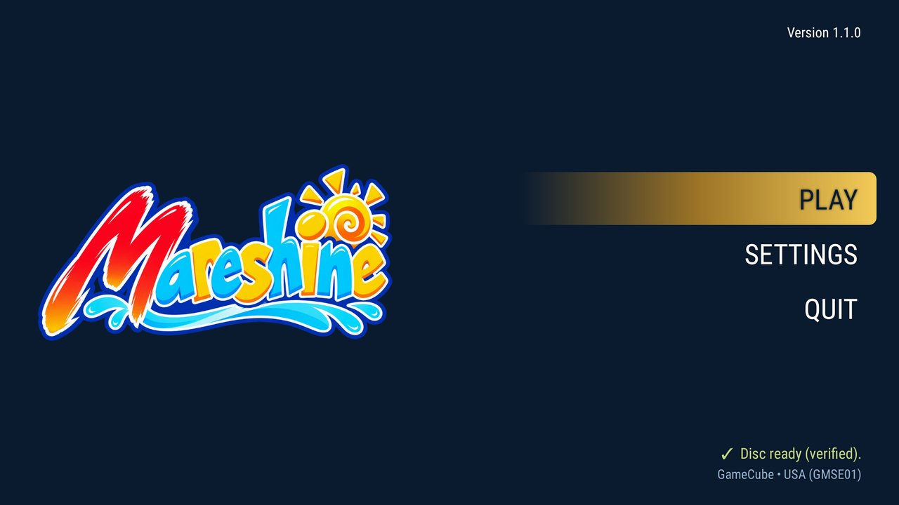
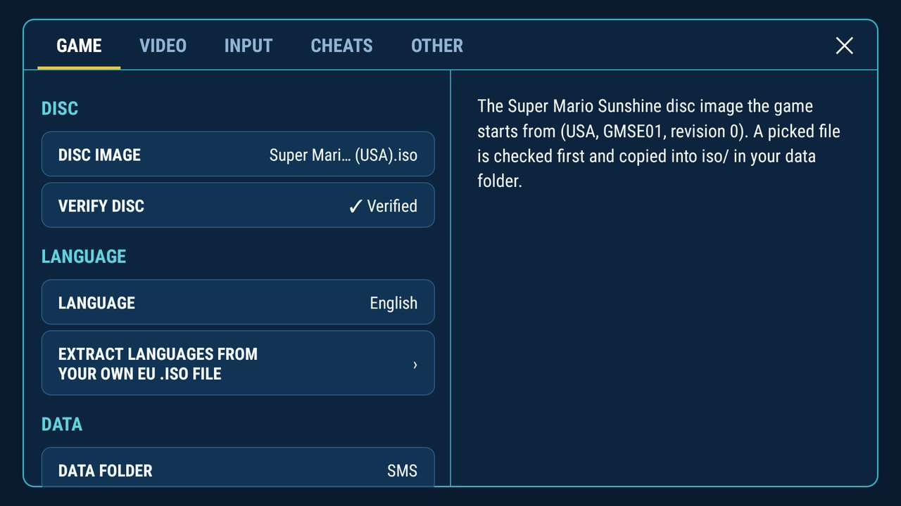
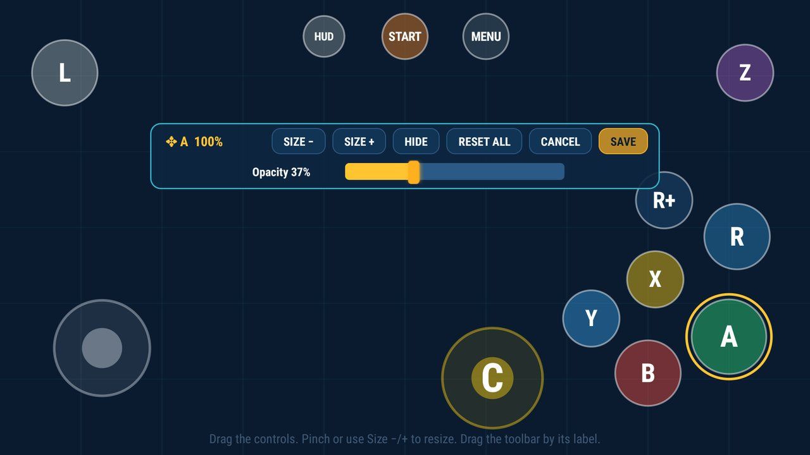

<p align="center">
  
</p>

# Mareshine

**Mareshine** is an Android port of *Super Mario Sunshine* (GameCube), built natively from the
[Super Mario Sunshine decompilation](https://github.com/doldecomp/sms) with an OpenGL ES 3 renderer.
It is a fork of [jbcgames/sms-android](https://github.com/jbcgames/sms-android) and brings over many
features of [chasem-dev's PC port](https://github.com/chasem-dev/sms-pc-port).

**No game data is included.** You need your own copy of the game: the North American disc
(GMSE01, revision 0) as an `.iso`. To play in a language other than English, you also need your
own copy of the European release (GMSP01) as an `.iso`.

<p align="center">
  
  
  
</p>

## Features

### New in Mareshine

- **Modern UI** inspired by [Dusklight](https://github.com/TwilitRealm/dusklight): a launcher, tabbed
  settings (Game, Video, Input, Cheats, Other) with a description for
  every option, usable with a remote, a controller or touch, and an in-game pause menu (resume,
  settings, restart, quit)
- **Data folder** (as in Dusklight): one folder of your choice holds your settings, saves, disc
  image, texture packs, cutscenes, language packs and logs, and stays when the app is reinstalled
- **Background shader compilation**: the game's known shaders (from the PC port's list) are
  compiled in the background while the menu shows and while you play, with a small notice,
  inspired by Dusklight, that can be turned off
- **Adaptive layout**: the app's menus and settings adapt to the display size, so they look right
  on phones, tablets and TVs alike, clear of camera cutouts, system bars and rounded corners
- **Customizable touch controls**: a touch layout editor (position and size of every button,
  opacity, hide when idle)
- **Controller settings**: controller choice, button mapping, dead zone, sensitivity and stick
  calibration
- **MP4 cutscenes**: the HD cutscenes can be converted to MP4 on the device and played with the
  hardware video decoder, for devices too weak to play them in the game's own THP format, which
  has to be decoded in software
- **Cutscene frame**: an image fills the bars beside the 4:3 movies, with its own frame for movies
  that need one, faded in and out
- **Movies at their true shape**: wide movies are scaled across the 16:9 screen instead of sitting
  in the 4:3 area, and dark capture edges are hidden under the frame
- **HD texture packs in the app**: download the Super Mario Sunshine UHD texture pack in HD or
  Ultra HD and its HD extras right in the app, turn them on or off, or use your own texture pack
  (compatible with Dolphin texture packs for the North American version)
- **HD cutscenes in the app**: download the PC port's HD cutscene pack, rebuilt from your own disc
  and checked
- **Subtitles in cutscenes**: the movies' subtitles in the game's language, shown even when they
  are off in the game's own options (on by default, can be turned off)
- **Save states**: five slots in the pause menu (save, load, delete, with a picture of the moment);
  quick save and quick load with the SAVE and LOAD touch buttons or, on a controller, the hotkey
  (Select + R1 saves, Select + L1 loads, all freely mappable)
- **Updates**: Mareshine checks GitHub for a new release once a day and offers it; it is downloaded
  and installed only after you confirm
- **Game languages on the device**: French, German, Spanish and Italian, built on the device from
  your own European disc; nothing is downloaded
- **Safety and help**: a disc check before the game starts, saves written safely, logs and crash
  reports, and a Recommended (HD) graphics preset
- **App languages**: English, German, Spanish, French and Italian

### Brought over from [chasem-dev's PC port](https://github.com/chasem-dev/sms-pc-port)

- **HD cutscene pack**: the PC port's HD versions of the game's movies
- **Shader warm-up**: each stage's shaders are prepared while it loads, so new areas stutter far
  less
- **120 FPS**: the PC port's framerate patches, as an option beside 30 and 60 FPS
- **Save state system**: saving and loading the game exactly at any moment in a level (on Android
  exactly within one run of the app, by position after a restart)
- **Cheats**: god mode, infinite lives, infinite FLUDD, movement speed, jump height, coin
  multiplier
- **Game language support**: the game code that plays the North American version in other
  languages

### From [jbcgames' sms-android](https://github.com/jbcgames/sms-android)

- The native Android port itself: the game built from the decompilation with an OpenGL ES 3
  renderer, touch controls, controller support, widescreen, HD texture pack support, and graphics
  options such as
  internal resolution, MSAA, anisotropic filtering, FXAA and draw distance

## Requirements

- Android 8.0 or newer, 64-bit ARM (`arm64-v8a`), OpenGL ES 3.0
- Your own *Super Mario Sunshine* disc image: North America, GMSE01, revision 0

The APK has been tested extensively on an **NVIDIA Shield TV** and a **Pixel 9 Pro**.

## Getting started

1. Install the APK.
2. Open Mareshine and pick your disc image (Settings → Game → Disc image), or place it in `iso/`
   inside the data folder. It is checked first.
3. Optionally choose a data folder (Settings → Game → Data folder) and download a texture pack or
   the HD cutscenes (Settings → Video).
4. Press **Play**.

## Building

The Android app is built with Gradle from the `android/` folder; the game code comes from the
`decomp/` submodule and is compiled by CMake through the Android NDK.

```sh
git submodule update --init --recursive
cd android
./gradlew assembleRelease
```

You need JDK 17 and the Android SDK with NDK and CMake 3.22.1. The APK ends up in
`android/app/build/outputs/apk/release/`. Desktop builds are described in [BUILD.md](BUILD.md).

## Credits

- **[jbcgames](https://github.com/jbcgames/sms-android)**: the original Android port this project
  continues
- **[chasem-dev](https://github.com/chasem-dev/sms-pc-port)**: the PC port, its graphics layer,
  HD cutscene pack, shader warm-up, cheats and framerate patches
- **[doldecomp](https://github.com/doldecomp/sms)**: the Super Mario Sunshine decompilation
- **[TwilitRealm](https://github.com/TwilitRealm/dusklight)**: Dusklight, whose launcher, data
  folder and background shader compilation inspired Mareshine's
- **qashto and razius**: the Super Mario Sunshine UHD texture pack
- **Libraries**: SDL2, stb, Dear ImGui, bcdec
- **TheM3dium**: the Android improvements in this fork

### About how it was made

Mareshine was developed with the help of an AI assistant (Claude by Anthropic) and tested by hand
on real devices. The logo, the app icon and the cutscene frames were created with the help of
ChatGPT (OpenAI) and then edited by hand. Bug reports are welcome.

## License

Mareshine's own changes are under the MIT License; the parts that come from other projects keep
their own terms (the PC port is MIT, the decompilation CC0). See [LICENSE.md](LICENSE.md).

## Disclaimer

Mareshine is an unofficial fan project and is not affiliated with, endorsed or sponsored by
Nintendo. *Super Mario Sunshine* and all related names and characters are trademarks and property
of Nintendo. This project contains no game data, assets or copyrighted material from the game; you
must own the game and use your own disc image. Please do not ask for or share game files.
Provided as is, without any warranty.
